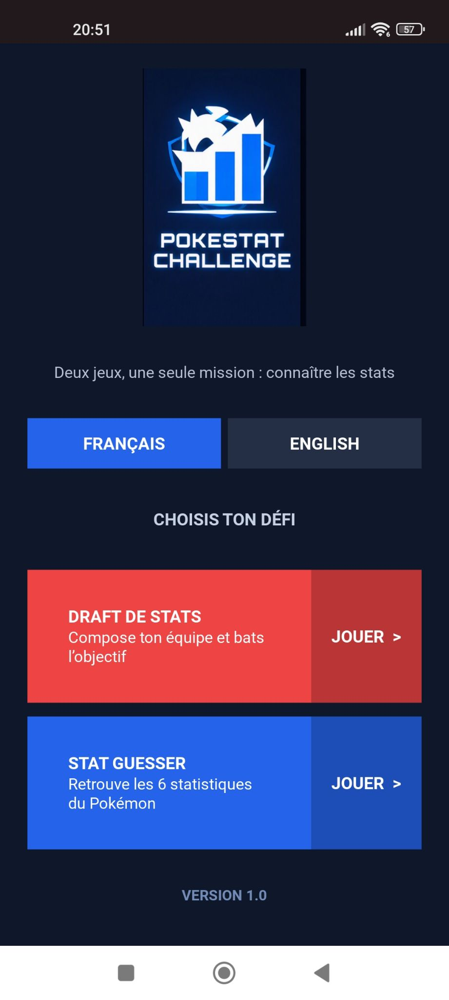
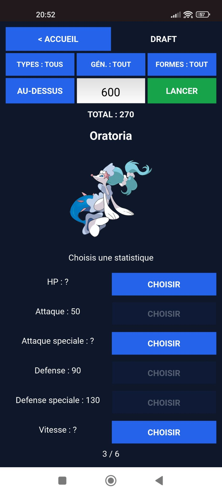
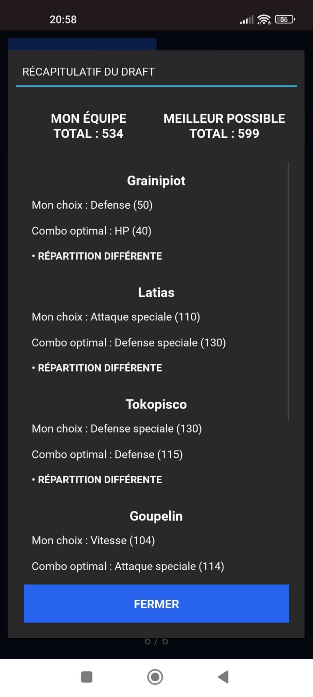
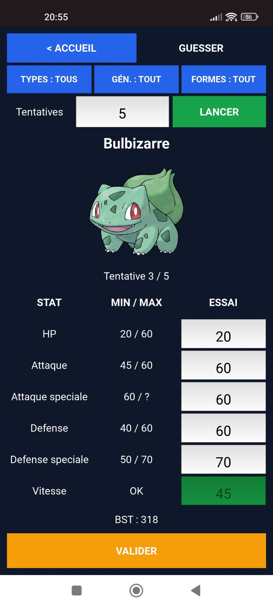
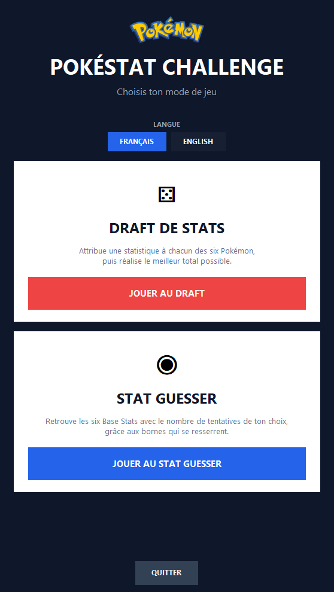
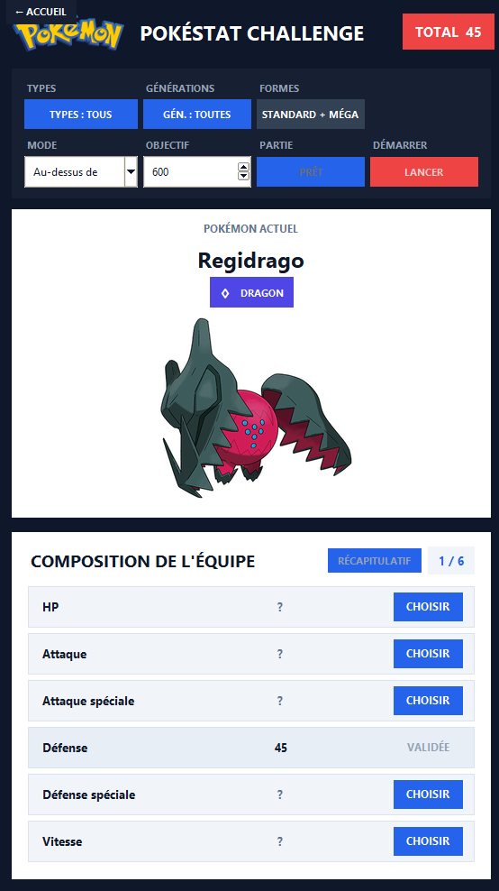
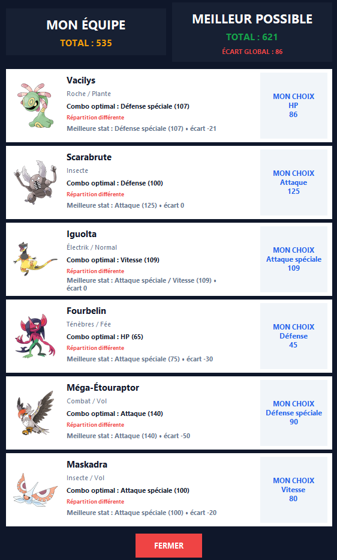
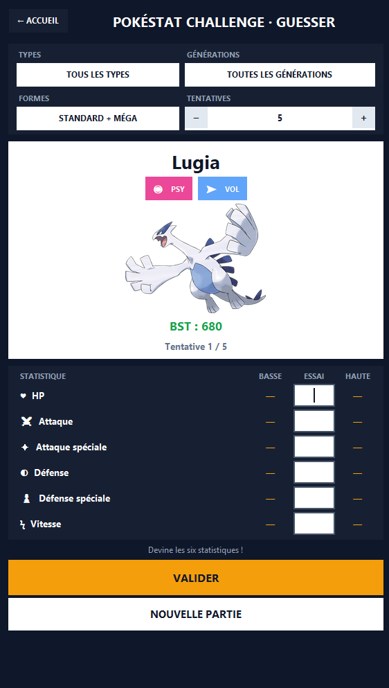

# PokeStat Challenge

Jeu de statistiques disponible sur **Android** et **Windows**, avec deux modes : **Stat Draft** et **Stat Guesser**.

## Télécharger PokeStat Challenge

**[Accéder aux téléchargements de la version 1.0.0](https://github.com/Rowmanow/PokeStat-Challenge/releases/tag/v1.0.0)**

Choisissez le fichier correspondant à votre appareil :

- **Android** : `PokeStat-Challenge-Android-v1.0.0.apk`
- **Windows** : `PokeStat-Challenge-Windows-v1.0.0.zip`

> N'utilisez pas les archives automatiques `Source code (zip)` et `Source code (tar.gz)`. Elles ne correspondent pas aux versions prêtes à lancer.

---

## Installation sur Android

1. Ouvrez la [page des téléchargements](https://github.com/Rowmanow/PokeStat-Challenge/releases/tag/v1.0.0).
2. Téléchargez `PokeStat-Challenge-Android-v1.0.0.apk`.
3. Ouvrez le fichier APK sur votre téléphone.
4. Si Android le demande, autorisez temporairement l'installation depuis votre navigateur ou votre gestionnaire de fichiers.
5. Appuyez sur **Installer**.
6. Lancez **PokeStat Challenge** depuis l'écran d'accueil.

Une connexion Internet est nécessaire lorsque certaines données ou illustrations doivent être récupérées pour la première fois.

---

## Installation sur Windows

### Prérequis

- Windows 10 ou Windows 11
- Python 3.10 ou une version plus récente
- Une connexion Internet lors du premier chargement de certaines données

### Installation

1. Ouvrez la [page des téléchargements](https://github.com/Rowmanow/PokeStat-Challenge/releases/tag/v1.0.0).
2. Téléchargez `PokeStat-Challenge-Windows-v1.0.0.zip`.
3. Faites un clic droit sur l'archive téléchargée.
4. Sélectionnez **Extraire tout**.
5. Ouvrez le dossier extrait.

> Ne lancez pas le jeu directement depuis l'archive ZIP. Tous les fichiers doivent d'abord être extraits.

### Installer Pillow

Dans le dossier extrait :

1. cliquez dans la barre d'adresse de l'Explorateur de fichiers ;
2. saisissez `powershell` ;
3. appuyez sur Entrée ;
4. exécutez :

```powershell
py -3 -m pip install -r requirements.txt
```

### Lancer le jeu

Double-cliquez ensuite sur :

```text
Pokestat-Challenge.vbs
```

Le lanceur démarre le jeu sans conserver de fenêtre de terminal à l'écran.

Vous pouvez également lancer l'application manuellement :

```powershell
py -3 accueil.py
```

Si le lancement échoue, un fichier `erreur_lancement.txt` sera créé dans le dossier du jeu.

---

## Modes de jeu

### Stat Draft

Composez une équipe de six Pokémon en attribuant une statistique différente à chacun.

À la fin de la partie, un récapitulatif compare votre équipe :

- au meilleur combo possible en mode **Au-dessus** ;
- au plus faible combo possible en mode **En dessous**.

### Stat Guesser

Retrouvez les six statistiques de base du Pokémon en un nombre limité de tentatives.

Après chaque essai, les bornes minimales et maximales sont actualisées pour guider les tentatives suivantes.

---

## Fonctionnalités

- Interface en français et en anglais
- Filtres par types et générations
- Pokémon standards et Méga-Évolutions
- Formes d'Alola, Galar, Hisui et Paldea
- Tirage uniforme parmi les candidats autorisés
- Nombre de tentatives personnalisable dans le Guesser
- Modes Au-dessus et En dessous dans le Draft
- Calcul du combo optimal parmi les six Pokémon
- Cache local pour accélérer les chargements suivants
- Interface tactile sur Android
- Lanceur silencieux sur Windows

---

### Aperçu Android

<p align="center">
  
  
  
  
</p>

### Aperçu Windows

<p align="center">
  
  
  
  
</p>
---

## Signaler un problème

Utilisez l'onglet **Issues** :

**[Signaler un bug](https://github.com/Rowmanow/PokeStat-Challenge/issues/new/choose)**

Merci de préciser :

- le modèle du téléphone ou de l'ordinateur ;
- la version Android ou Windows ;
- la langue utilisée ;
- le mode de jeu concerné ;
- les filtres sélectionnés ;
- les étapes permettant de reproduire le problème ;
- une capture d'écran si possible.

---

## Confidentialité

PokeStat Challenge ne demande pas de compte utilisateur et ne collecte pas volontairement de données personnelles.

Certaines données et illustrations nécessaires au jeu sont téléchargées puis conservées dans le cache local de l'application.

Consultez la [politique de confidentialité](PRIVACY.md).

---

## Avertissement

PokeStat Challenge est un projet communautaire non officiel.

Pokémon et les noms associés appartiennent à leurs ayants droit respectifs. Ce projet n'est ni affilié, ni approuvé, ni sponsorisé par Nintendo, Game Freak ou The Pokémon Company.

## Licence

Aucune licence open source n'est accordée pour le moment. Le code est visible à des fins de test et d'évaluation.

Consultez [LICENSE.md](LICENSE.md).
